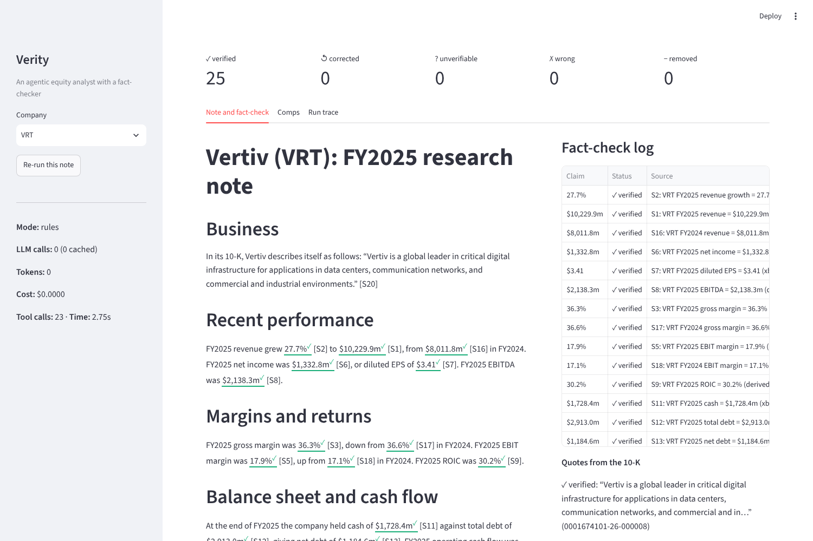
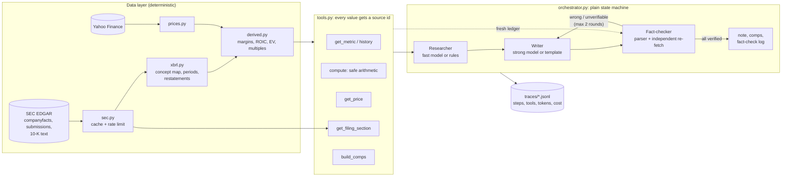

# Verity: an agentic equity analyst with a fact-checker

> Verity is a multi-agent system that researches a company from its SEC filings, writes a comps table and a short research note, and then has a separate fact-checking agent verify every number against the filing — and I measured how many errors the fact-checker catches.

It covers Delta Electronics' US-listed data-centre power and cooling peers (Vertiv, Eaton, nVent, Modine, Hubbell, GE Vernova, Johnson Controls, Trane, Super Micro, Powell). It is the companion project to my [Delta Volts](https://github.com/Anou-shka/delta-volts) initiation on Delta Electronics.



## Headline results

| What | Result | Where from |
|---|---|---|
| Fact-checker **recall** on planted errors | **98.2%** (884 of 900) | [Experiment 3](docs/results.md#experiment-3-fact-checker-catch-rate) |
| Fact-checker **false-alarm rate** | **0.0%** (0 of 7,117 correct claims) | same |
| Errors **left after revision** | **2.7%** (24 of 900) | same |
| Weakest error type | a true number described as something else: 87.7% caught | same |
| Data layer vs 10-K, checked by hand | 25 of 25 values match | `tests/test_xbrl.py` |
| Comps table vs metrics table | 110 of 110 cells identical | `tests/test_tools.py` |
| Cost per note, rules mode | $0, about 2.3s, 23 tool calls | [run costs](docs/results.md#cost-and-time-per-note) |
| Extraction accuracy, agent vs no-tools baseline | **pending: needs an API key** | harness ready: `eval/extraction.py` |

Read the caveat before quoting these numbers. They come from the **deterministic** writer and checker (no LLM). This environment had no API key, so they show what tool-based verification catches in regular, template prose. LLM prose is messier, so treat them as an upper bound until the LLM run is done. The weakness they expose is real: when a number is correct but described as the wrong thing, a value check cannot see it. Full results: [`docs/results.md`](docs/results.md).

## How it works



**Rules I kept to:**

1. **Plain Python, no agent framework.** The agent loop is `run_tool_loop` in `llm.py` (about 20 lines) and the orchestrator is a `while state != "done"` loop.
2. **LLMs never do arithmetic.** Every ratio, growth rate, median and multiple is computed in Python (`derived.py`, `compute`, `peer_median`). The model only copies display strings.
3. **Every number is traceable.** Each tool result is registered in a ledger with an id (`S7`). The writer must put `[S7]` after the number. The source records the XBRL concept, period and accession number, the formula and its input ids, or the price and its date.
4. **Measure, don't claim.** See the tables above.

**The fact-checker** does not trust the writer or what the writer was given:
- **Extraction.** It finds every number with a parser (money, %, multiples, per-share), so no figure can be skipped.
- **Re-fetching.** It reads the citation to learn what the number claims to be, then re-fetches that value through **its own** ToolBox and ledger.
- **Checks.** It compares the value within tolerance (0.5% for reported figures, 0.1pp for ratios), the fiscal year written next to it, and whether the words name the cited metric.
- **Quotes.** Quoted 10-K text must appear in the filing.

**Revision rules:**
- **Wrong numbers and years** are corrected.
- **Uncited numbers** are deleted.
- **A made-up number with a borrowed citation** is also deleted, not patched, so it can't be laundered into a true-looking claim.

## Run it

```bash
git clone https://github.com/Anou-shka/Verity.git && cd Verity
pip install -r requirements.txt
make all          # rebuild metrics, run all experiments, demo, tests — offline, no API key
make app          # streamlit app on the committed outputs
```

| Command | What it does |
|---|---|
| `make notes` | research, write and fact-check a note for all 10 companies (`outputs/<TICKER>/`) |
| `make demo` | the Vertiv note with 4 planted errors, to watch the fact-check and revision loop (`outputs/VRT-demo/`) |
| `make eval` | all experiments: `eval/results/`, `docs/results.md`, `docs/figures/` |
| `PYTHONPATH=src python -m verity.cli run VRT --provider anthropic` | the same pipeline with Claude (needs `pip install -r requirements-llm.txt` and `ANTHROPIC_API_KEY`) |
| `... --replay` | serve every model call from `data/llm_cache/`: no key, no cost |

**Models.** With `VERITY_PROVIDER=anthropic`:
- The Researcher uses `claude-haiku-5-5` (fast, cheap).
- The Writer uses `claude-opus-5-5` (strong), with server-side refusal fallbacks enabled.

**Other providers.** OpenAI and a local model via Ollama are supported through the same adapter. The defaults are set in `.env` (see `.env.example`).

**Outputs per company:**
- `note.md`
- `comps.csv`
- `factcheck.json` / `factcheck.md` (every claim with its status and source)
- `research_pack.json` (every source)
- a trace in `traces/`

## Repo map

```
config/            concept_map.yaml (XBRL tag options), settings.yaml (dates, tolerances, splits), universe.yaml
src/verity/        sec.py, xbrl.py, derived.py, prices.py, tools.py, llm.py, trace.py, orchestrator.py, cli.py, inject.py
src/verity/agents/ researcher.py, writer.py, fact_checker.py
eval/              catch_rate.py (exp 3), extraction.py (exp 1-2), run_all.py, results/
app/               streamlit_app.py
outputs/ traces/   committed demo runs
data/              cache/ (SEC + prices, gzipped), processed/ (metrics tables)
docs/              results.md, governance-memo.md, case-study.md, defence.md, milestone-notes.md
tests/             56 tests, all offline
```

## Governance

[`docs/governance-memo.md`](docs/governance-memo.md) is a pre-launch AI risk assessment written the way a bank's second line would review it. It covers risk materiality (Impact, Complexity, Reliance), failure modes, the measured evidence, controls, and a mapping to the MAS FEAT principles, MAS's AI Risk Management Guidelines and the MindForge Handbook.

## Limitations

- **US filers only.** Coverage depends on SEC XBRL. Delta itself (TWSE) cannot be covered this way.
- **XBRL tagging is inconsistent.**
  - 11% of values had to be rebuilt from other tags, and each rebuild was checked against a 10-K.
  - Anything tagged only by segment or product (TT's cost of sales) is invisible to `companyfacts`.
  - A new company needs new checks.
- **Qualitative claims are harder to verify.**
  - Quotes are checked word for word against the filing. Paraphrases are not checked.
  - In LLM mode, a model only flags unsupported statements; it does not verify them.
  - The checker's weakest case is meaning: a true number described as the wrong thing.
- **LLM non-determinism.** Replay mode makes runs repeatable, but a fresh run can differ.
- **The headline numbers are not LLM numbers.** They come from the template writer. The LLM experiments are built but not yet run.
- **Small universe.** 10 companies, 6 fiscal years, one sector. 900 planted errors is enough to rank error types, not to promise a rate in production.
- **Valuation simplifications.**
  - Multiples use the latest fiscal year, not LTM, so JCI and POWL (September year-ends) are a year staler.
  - EV ignores minorities and leases.
  - Prices are fixed at 16 Oct 2026.
