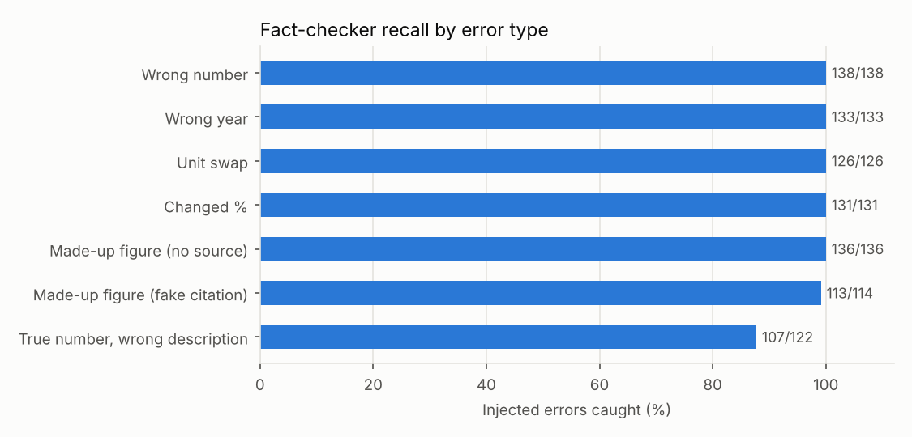
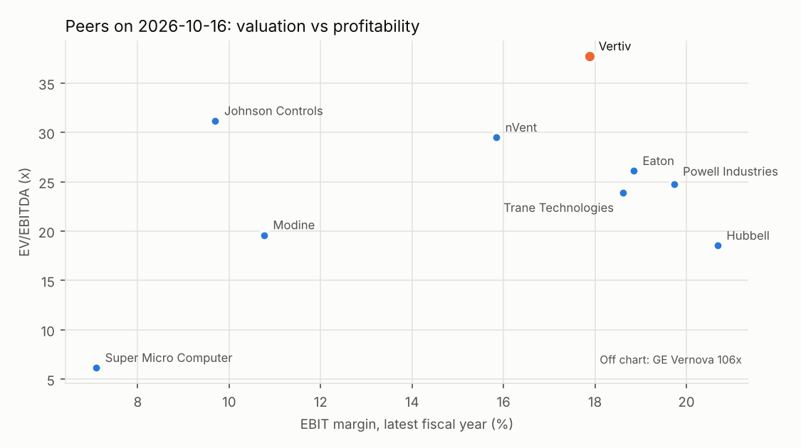

# Results

Every number on this page is produced by `make eval` (`python -m eval.run_all`) and stored in `eval/results/`. Nothing here is typed by hand.

## What has been measured, and in which mode

| Experiment | Status | Mode |
|---|---|---|
| 3. Fact-checker catch rate (error injection) | **done** | template writer + rules checker (no LLM) |
| Run cost and time per note | **done** | rules |
| 1. Extraction accuracy (360 questions ready) | **pending: needs an API key** | — |
| 2. Baseline vs agent | **pending: needs an API key** | — |

The development environment had no LLM API key, so experiments that need a model have not been run. Their harness is complete and tested; `VERITY_PROVIDER=anthropic make eval` fills them in and replaces this note.

## Experiment 3: fact-checker catch rate

Setup: for each of the 10 companies, a correct note was written, then 30 times 3 known errors were planted at random (seed 20261019). The fact-checker checked each note, and the revision loop (max 2 rounds) tried to fix what it flagged.

| | Result |
|---|---:|
| Injected errors | 900 |
| **Recall** (caught) | **884 / 900 = 98.2%** |
| **False alarms**, clean notes | **0 / 250 = 0.0%** |
| False alarms, untouched claims in injected notes | 0 / 6,867 = 0.0% |
| **Errors left after revision** | **24 / 900 = 2.7%** |

| Error type | What was planted | Injected | Caught | Recall | Left after revision |
|---|---|---:|---:|---:|---:|
| Wrong number | a cited figure changed by 3–25% | 138 | 138 | 100.0% | 0 |
| Wrong year | the fiscal year next to a figure changed by ±1 | 133 | 133 | 100.0% | 0 |
| Unit swap | $m written as $bn, % divided by 10, $ read as cents | 126 | 126 | 100.0% | 0 |
| Changed % | a percentage moved by 0.3–3.0 points | 131 | 131 | 100.0% | 0 |
| Made-up figure (no source) | a new sentence with an invented figure and no citation | 136 | 136 | 100.0% | 0 |
| Made-up figure (fake citation) | an invented figure with a real citation id | 114 | 113 | 99.1% | 1 |
| True number, wrong description | a true, correctly cited figure described as something else | 122 | 107 | 87.7% | 23 |

**How to read this.**

- Errors in the *number* are caught almost always, because the checker re-fetches the cited value with its own tools and compares within tolerance (0.5% for reported figures, 0.1pp for ratios). Year errors are caught because each figure is tied to the fiscal year of its source.
- The weak spot is **meaning**. When a true number is cited correctly but described as something else ("data-centre revenue was $10,229.9m [S1]", where S1 is total revenue), the value check passes. A keyword check on the words before the number catches most of these, but not when the wrong description uses the right keyword ("revenue"). That is the 15 misses above, plus one invented "orders" figure that happened to equal a cited zero.
- **Caught is not the same as fixed.** Some misdescriptions are caught only because the year is wrong; the revision then corrects the year, and the misdescription survives. The "left after revision" column counts an inserted sentence as residual whenever its wording survives, even if its number was "corrected". This is why it is larger than the misses. Fabricated figures whose sentence does not name the cited metric are deleted, not patched, so a fake claim is never laundered into a true-looking one.
- **Caveat: the writer here is a template, not an LLM.** Template prose is regular, which makes extraction easy. LLM prose is messier ("just over $10bn", numbers spelled out, figures split across sentences), so these numbers are an upper bound for the checker's recall until the LLM run is done.

## Experiments 1 and 2: extraction accuracy, agent vs no-tools baseline

**Pending.** 360 questions are generated from the XBRL ground truth (10 companies × 12 metrics × latest 3 fiscal years). Each is asked twice: once to the tool-using agent, once to a single model call with no tools. Misses are typed as wrong year, wrong unit, wrong concept, made-up number or no answer (`eval/extraction.py`).

What is already measured is the data layer the agent's tools sit on: **25 of 25** values pinned in `tests/test_xbrl.py` match the figures read by hand from five 10-Ks, and the comps table matches the metrics table exactly (110 of 110 cells, `tests/test_tools.py`).

## Cost and time per note

| Company | Mode | LLM calls | Tokens | Cost | Tool calls | Seconds | Claims verified | Quotes verified | Revision rounds |
|---|---|---:|---:|---:|---:|---:|---:|---:|---:|
| VRT | rules | 0 | 0 | $0.0000 | 23 | 2.32 | 25/25 | 4/4 | 0 |
| ETN | rules | 0 | 0 | $0.0000 | 23 | 2.03 | 25/25 | 4/4 | 0 |
| NVT | rules | 0 | 0 | $0.0000 | 23 | 1.75 | 25/25 | 4/4 | 0 |
| MOD | rules | 0 | 0 | $0.0000 | 23 | 2.36 | 25/25 | 4/4 | 0 |
| HUBB | rules | 0 | 0 | $0.0000 | 23 | 2.04 | 25/25 | 4/4 | 0 |
| GEV | rules | 0 | 0 | $0.0000 | 23 | 2.2 | 25/25 | 4/4 | 0 |
| JCI | rules | 0 | 0 | $0.0000 | 23 | 2.07 | 25/25 | 4/4 | 0 |
| TT | rules | 0 | 0 | $0.0000 | 23 | 1.96 | 25/25 | 4/4 | 0 |
| SMCI | rules | 0 | 0 | $0.0000 | 23 | 2.22 | 25/25 | 4/4 | 0 |
| POWL | rules | 0 | 0 | $0.0000 | 23 | 1.98 | 25/25 | 4/4 | 0 |

In rules mode a note costs nothing and takes a few seconds; LLM-mode cost appears here once it has been run.

## Peer valuation snapshot

